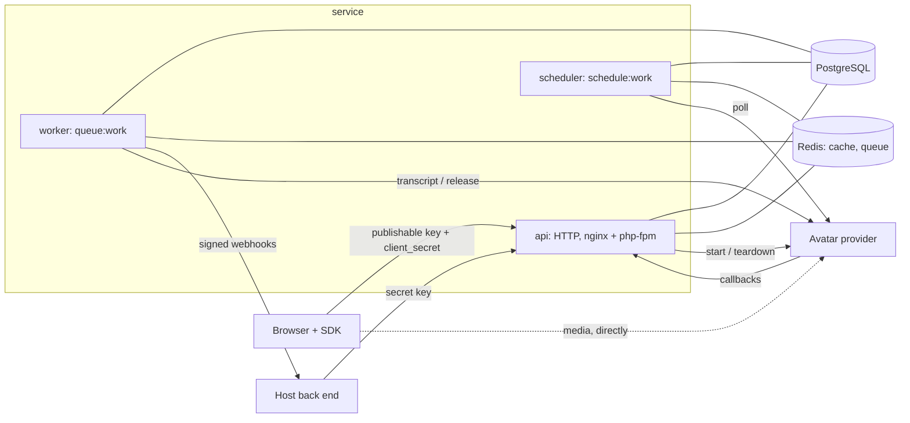
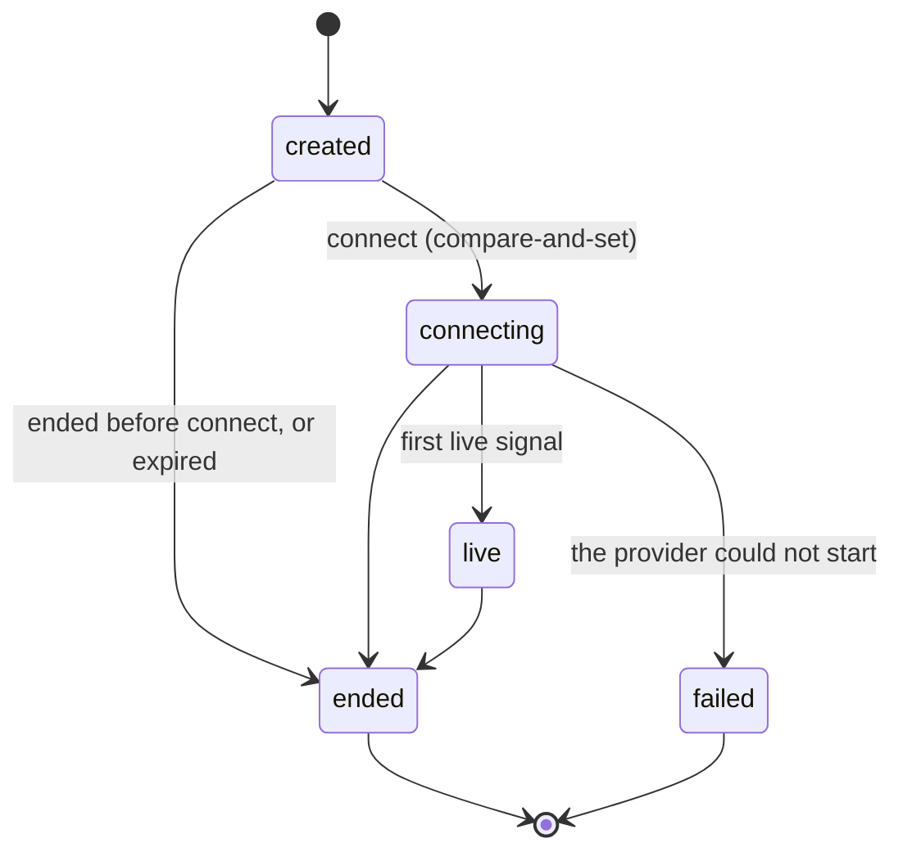
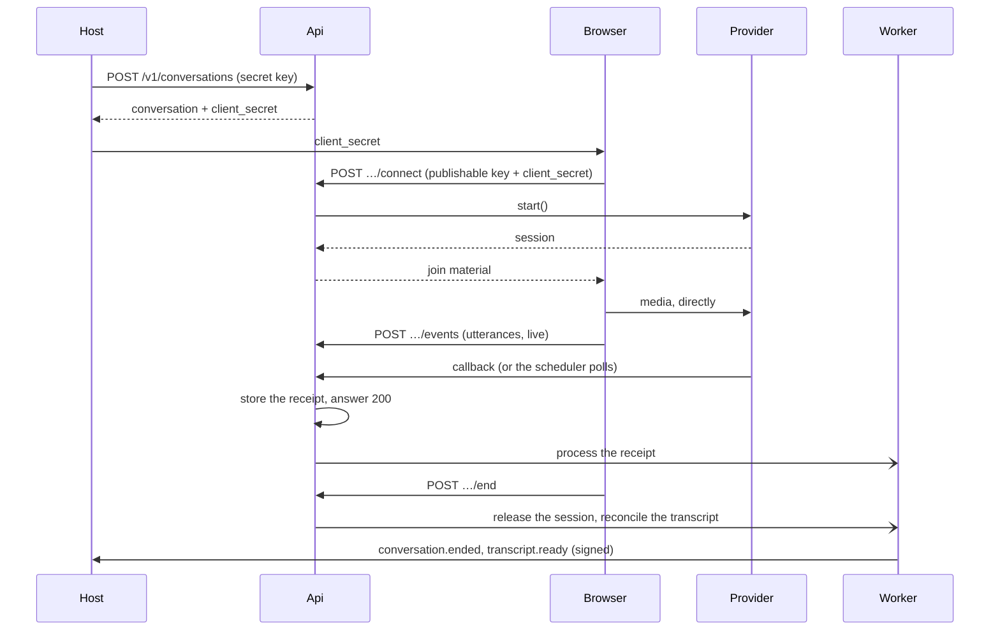

# Architecture

How the service is put together and why. The specifications and the design it was built from are in
[`openspec/changes/hr-avatar-engine/`](../openspec/changes/hr-avatar-engine/design.md); this page is the map.

## Principles

- **The account is the only tenant key.** Every table except the platform catalogue (`llm_models`) and `accounts`
  itself carries `account_id`, and every query is scoped by it through a global scope that **fails closed**: with
  no account bound, a query on an account-owned model throws instead of returning everything. The only reads that
  run before an account is known are the two credential lookups, each of which returns a row only on a credential
  match and binds the account from that row: the key resolver (matched by the key's hash) and the inbound
  provider-callback lookup (matched by the hash of an unguessable per-conversation token).
- **Provider-agnostic core.** Provider specifics live in adapters behind one interface. Nothing outside an adapter
  branches on a provider name; a test rejects a provider id written anywhere else, and others check that every
  model is scoped and that no authenticated route reaches another account's data.
- **No host concepts.** A host passes an opaque `external_ref` and `metadata` and gets them back as sent. The
  service has no notion of what a conversation is for.
- **A conversation is single-use and its row is the ledger.** One compare-and-set decides who connects, and the
  state machine decides what can happen next.

## Components

- **api** answers every HTTP request. Migrations run once per deploy, before it takes traffic.
- **worker** runs the queued work: webhook deliveries, transcript reconciliation, releasing provider sessions,
  processing provider events, syncing avatar configs.
- **scheduler** runs the conversation sweeper (every minute) and the provider poller. There is exactly one.

## The provider contract

`App\AvatarProviders\AvatarProvider` is everything a provider does for a conversation, in host-neutral terms.
Value objects go in and out (`ConversationSpec`, `ProviderSession`, `JoinMaterial`, `TranscriptLine`,
`SessionStatus`, `ProviderEvent`), so no caller sees a provider's wire format.

| Method | What it is for |
|---|---|
| `ingestion()` | How the provider's events arrive: `Callback` (it calls the service), `Poll` (the service asks it) or `None`. This is how the core avoids asking which provider it is talking to. |
| `describe()`, `validateConfig()` | What an avatar config can hold for this provider, and whether a given one is valid. Makes no provider call. |
| `syncRequired()`, `sync()` | Creates or updates the provider-side objects a config needs before a conversation can start (an avatar config is `not_required`, `pending`, `synced` or `failed`). |
| `catalogue()` | What the account can pick from at the provider (avatars, voices, personas). |
| `start()` | Starts a session for a conversation and returns what the browser needs to join it. Runs outside any database transaction. |
| `teardown()` | Ends a session and releases what was created for it. Best effort and idempotent. |
| `fetchTranscript()` | The provider's transcript of a finished conversation. |
| `callbackTranscript()` | The transcript a callback payload already carries, read the way a fetched one is. |
| `fetchSession()` | Whether the session has ended, and the provider's own reason. An error is never reported as an end. |
| `parseCallback()` | Turns a provider's callback body into the service's own provider events. |

Adding a provider is one adapter class and one entry in the registry (`config/hr-avatar.php`), plus the credential
entries when it takes a key. The registry hands out the adapter by id; the built-in `mock` provider is the
reference implementation and needs no account anywhere.

The browser side has the matching seam: the `transport` in the connect answer (`daily`, `liveavatar` or `mock`)
names which SDK transport can join the session.

## Lazy start at connect

Creating a conversation makes no provider call and needs no provider credential. The provider is asked for a
session only when the browser connects:

1. The provider's key, and the language model's key when the config binds one, are resolved first. A missing one is
   a `422` and leaves the conversation `created`.
2. For a provider that calls back, the service must have a usable `HRA_PUBLIC_BASE_URL`; without one it answers
   `503` and changes nothing.
3. **Compare-and-set** `created → connecting`: exactly one caller wins. A second connect is `already_connected`
   (or `invalid_state` when the conversation is over).
4. For a provider that calls back, a 32-byte token is minted and only its sha256 is stored; the plain token exists
   only inside the callback address handed to the provider.
5. `start()` runs outside any transaction. If it fails, the conversation is `failed` and the browser gets `502`
   (`429` when the provider is at capacity). If the conversation ended while the session was starting, the new
   session is released.
6. The provider's references are stored, and the browser gets only its side of the session.

## Conversation state machine

Every change goes through one class (`ConversationLifecycle`), as one conditional `UPDATE` that names the states it
may leave; the first writer wins and only the winner emits a webhook. A terminal state never changes, and a
repeated ending is an idempotent success.

A conversation ends for one of these reasons: `client` (the browser), `api` (the host), `max_duration` (the sweeper,
30 seconds after the maximum), `expired` (never connected within 15 minutes), `provider` (the provider reported it),
`provider_error` or `provider_capacity` (it failed to start). The provider's own words are kept apart in
`provider_end_reason`.

## Event flow

- **Browser events** are stored once each (the browser's `idempotency_key`), in order, with a server-assigned
  sequence. They are accepted while the conversation is open and for a minute after it ended (a batch that was stored already is still answered as a replay), and a conversation holds at most 10,000 of them.
- **Provider events** are stored first, as receipts, deduplicated on `(account, provider, idempotency key)`, and
  processed afterwards on the queue: an event is applied once however often it arrives.
- **The transcript is a merge, never a replacement.** The browser's lines are kept; the provider's lines are added
  when the same speaker's same text is not already there (one stored line accounts for one provider line). If the
  provider cannot deliver after five attempts, the transcript is `partial`.
- **Ending never depends on a callback.** An explicit end, the sweeper and the delayed release job are
  authoritative; a callback or a poll only makes it faster.

## Webhooks out

Each account registers up to 20 endpoints. Events are `conversation.live`, `conversation.ended` and
`transcript.ready`. A delivery row is written in the same transaction as the state change and sent after it
commits; it is retried with backoff, re-signed on every attempt with a fresh timestamp, and stops when the
endpoint is disabled or deleted. The body is signed with a random per-endpoint secret (`hra_whsec_…`), stored
encrypted and shown once. Destinations are vetted outside local development: https only, no credentials, and no private or internal address.
How a receiver verifies a delivery is in [API usage](api-usage.md#verify-a-webhook).

## Key model

| Credential | Looks like | Used by | Grants |
|---|---|---|---|
| Secret key | `hra_sk_{live\|test}_` + 96 hex | the host's back end | The scopes it was issued with (`*`, `conversations:write`, `avatar_configs:read`, …). A live secret key is rejected when sent with an `Origin` header, so it cannot be used from a browser. |
| Publishable key | `hra_pk_{live\|test}_` + 48 hex | the browser | Nothing on its own. Honoured only from an allowed origin, and only together with a client secret. |
| Client secret | an HS256 JWT bound to one conversation | the browser | The three browser calls for that one conversation: connect, send events, end. |
| Callback token | 64 hex in the callback address | the provider | One conversation's callbacks. |
| Webhook secret | `hra_whsec_…` | the receiving host | Verifying our deliveries. Ours to sign with, theirs to check with. |

Keys are stored as a sha256 hash plus an indexed prefix and compared with `hash_equals`; the raw key is shown once.
The resolver checks the hash first and only then whether the key expired or was revoked, so it cannot be used to
learn whether a key ever existed. `live` and `test` are labels of the key space, not separate data. Rotating a key
leaves the old one valid for an overlap (an hour by default) so a deployment can switch without a gap.

Provider and language-model credentials are encrypted at rest, hidden from serialization and never returned (at
most their last four characters). An account may store its own; the platform's `*_API_KEY` settings are the
fallback for an account that stored none.

## Errors

Every non-2xx answer is RFC 9457 Problem+JSON with a stable machine `code` (never localized), a `detail` that
never holds a secret or a provider's words, and a `request_id` that is also the `X-Request-Id` header. The
`Problem` schema and the answers every endpoint can give (401, 404, 422, 429) are documented once in the OpenAPI
document.

## Retention: an open item

There is **no purge** of transcripts, events, receipts or delivery payloads in this release, and the retention
periods are an **owner decision**, pending. See [the README](../README.md#retention-an-open-item).
